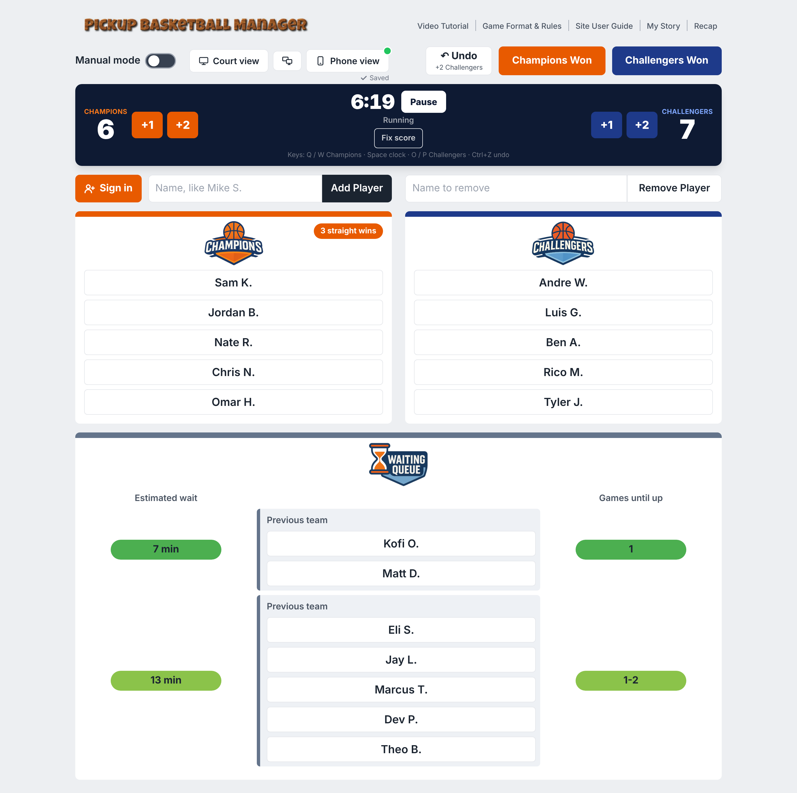
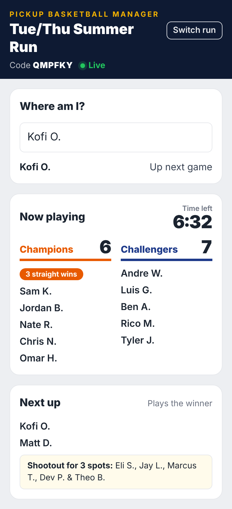
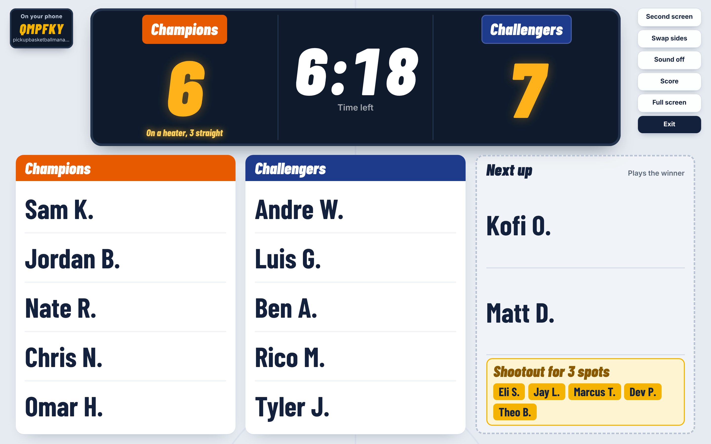
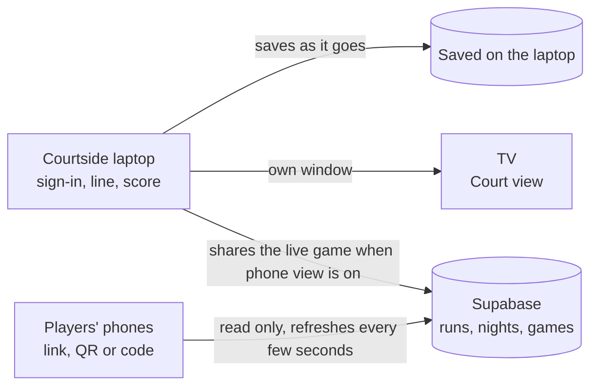

# Pickup Basketball Manager

A web app that runs pickup basketball nights at my gym. Players sign themselves in on a courtside laptop, and the app keeps the line fair, sets up the next teams, runs the shootouts for open spots and shows everyone on their phones where they stand.

**Status:** live at [pickupbasketballmanager.com](https://pickupbasketballmanager.com). It runs the Tuesday and Thursday summer games at my gym in Chicago. Try it with made-up players at [pickupbasketballmanager.com/?sample=1](https://pickupbasketballmanager.com/?sample=1). The code is private.

  
  
  

*Screens use made-up players and a pretend database.*

## My role

I own the product. I wrote the rules the app follows, decide what to build and what to cut, review a preview of every change and approve every release. I also test it live, both as the person running the night and as a player on a phone.

It started in 2024 with an early version of Claude. Today Claude agents (through Claude Code) write the code, the tests, the database changes and the tutorial video, which is recorded from the real app. ChatGPT reviews the plans and the live site before big changes. Nothing ships without my OK.

## Stack

React, TypeScript, Tailwind, Supabase (Postgres, sign-in, row-level security), Resend for email, Vercel for hosting.

## How it works

1. Players tap their name on the courtside laptop, or type a first name and last initial the first time.
2. The first ten fill two teams. Everyone else joins the line, with an estimated wait.
3. After each game the runner taps who won, or keeps score with a built-in 12-minute clock that knows the house rules. Winners stay, losers go to the back, and the next five step in.
4. When more people are waiting than there are open spots, the app runs a three-point shootout to decide who gets in.
5. A big Court view can go on a TV, and players can follow the score, the line and their own stats on their phones with no app or account.

## Decisions

- **The rules came before the code.** My first tries at writing the gym's rules as requirements kept losing people from the line. I started over with 15 to 20 flow-chart scenarios, walked Claude through each one and had it write the requirements. That version worked.
- **The courtside laptop works offline first.** It saves the night as it goes, and the database is an add-on. A dropped connection never stops a game.
- **Players never need an account.** Phones open the run by link, QR code or a 6-character code and can only read. The runner can reset the link at any time.
- **One screen runs the night.** A second laptop has to take over on purpose, so two screens can't overwrite each other.
- **Subs who lose go to the front of the line.** Someone who comes on mid-game, say for an injury, shouldn't lose their spot for a game they barely played.

## Quality

- I tested about 100 scenarios, fixed the edge cases that broke and reran them until every situation I could imagine was covered.
- 145 automated tests in 12 suites, all passing (October 19, 2026).
- Browser tests drive the real app at laptop and phone sizes with made-up players and a pretend database. 219 checks passed, including 81 of 81 in the phone suite (October 18, 2026).
- Database access rules are tested inside transactions that roll back, so testing never changes real data.
- Every release gets a preview I approve, a check that GitHub matches the tested files, and a check of the live site.

## Timeline

- Started in 2024 with the flow charts.
- First commit: February 27, 2025. The current repo starts March 27, 2025.
- Latest commit: October 19, 2026.

## What's next

- Player profiles, so a player's stats follow them across nights and devices.
- A simple way for other gyms to start their own run.
- Real nights of use next summer, so the stats reflect real games.

[kylegtobin.com](https://kylegtobin.com) · [LinkedIn](https://www.linkedin.com/in/kylegtobin/)
